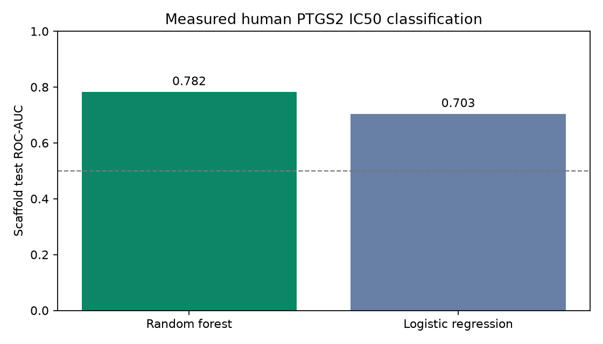
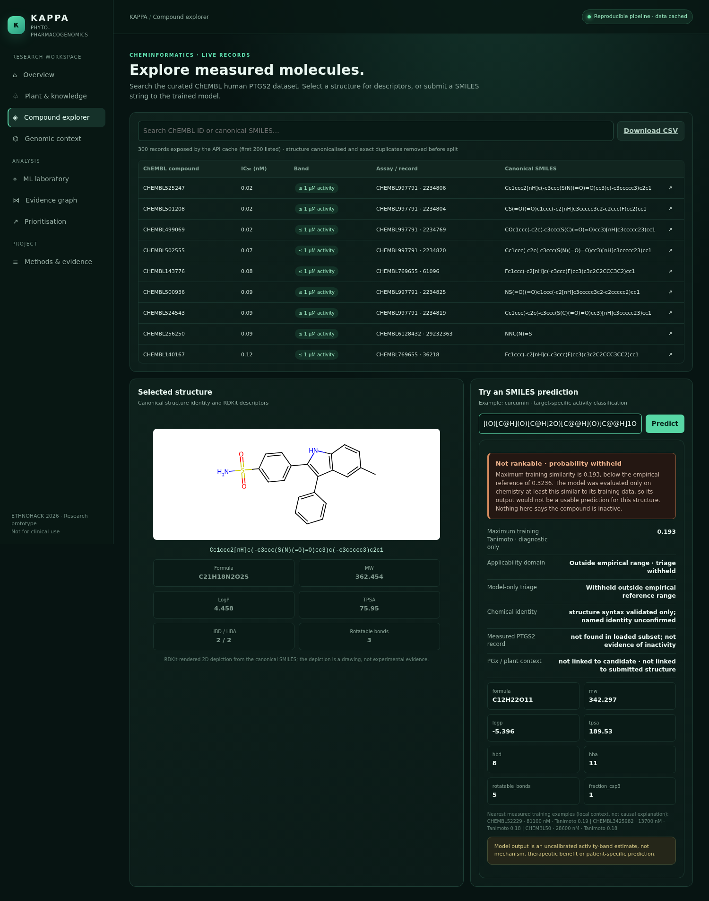

# Devpost form — copy-paste pack (EthnoHack 2026, submission 1283318)

Everything below is ready to paste into the fields you have open. Character limits are checked against the real
limits, and every link is an **absolute public URL** (Devpost does not resolve relative paths).

**Deadline: Sunday 8 November 2026, 10:00 Athens time (EET, UTC+2) = 09:00 Lagos (WAT, UTC+1) = 08:00 UTC.**

---

## Step 1 — Project overview

**Project name** (54 / 60 characters):

```
KAPPA — Knowledge-guided AI for Phyto-Pharmacogenomics
```

**Elevator pitch** (189 / 200 characters):

```
A research workbench that keeps plant occurrence, ethnobotany, measured PTGS2 assays, model estimates and PGx evidence separate — and refuses to rank molecules outside its empirical domain.
```

**Thumbnail:** upload `submission/thumbnail.png` (1800×1200, exactly 3:2, 119 KB).

---

## Step 2 — Project details

### Project story (paste as Markdown)

> Replace nothing; every link is live. If you want to shorten, cut the "How this differs" section last — it is
> the strongest defence against a novelty objection.

```markdown
## What KAPPA is

KAPPA is a runnable research workbench for natural-product drug discovery. It keeps five kinds of evidence
**separate and traceable**: botanical occurrence, a qualified traditional-use report, measured human PTGS2
(COX-2) assay data, uncalibrated model estimates, and pharmacogenomic guideline evidence. It is a research
prototype, not a clinical, therapeutic or efficacy tool.

**Source code:** https://github.com/AdemolaTolulope/kappa-ethnohack2026
**Slide deck (10 slides, PDF):** https://github.com/AdemolaTolulope/kappa-ethnohack2026/blob/main/presentation/rendered/KAPPA_pitch_deck.pdf

## The problem that inspired it

Natural-product evidence is spread across plant records, chemical structures, biochemical assays and human
genomic resources. The failure mode is not missing data — it is missing **evidence contracts**. A plant
occurrence gets read as efficacy, a model score gets read as validation, and an unrelated pharmacogenomic
association gets read as plant-specific. The resources themselves document this: LOTUS notes scarce
structure–organism interlinkages, NPASS explicitly separates *measured* from *similarity-estimated* activity, and
the 2026 compound-centric plant chemical space paper already links occurrence, taxonomy, scaffolds and ChEMBL
evidence.

So we did not try to build another database, and we do not claim to be the first integrated platform. We built the
narrower thing that is checkable: **an evidence-type contract enforced in code and in the interface, with an
explicit refusal rule.**

## What it does

- Ingests human PTGS2 (CHEMBL230) IC50 records from ChEMBL and curates them with pre-declared filters.
- Trains a class-weighted Random Forest against a logistic baseline on a **Bemis–Murcko scaffold-group holdout**.
- Refuses to rank: outside a training-derived similarity reference range, the model's triage value is `null` in
  the API and "**Not rankable · probability withheld**" in the UI, with the similarity value and the reason shown.
- Validates ethnobotanical records **fail-closed** — required authors, year, title, journal and URL/DOI, non-empty
  limitations, and the validator *rejects* any record that asserts a compound linkage.
- Demonstrates a verified, independent **CPIC CYP2C19–clopidogrel** guideline in a graph component that is
  deliberately disconnected from the phytochemical model.
- Serves everything through a FastAPI + single-file frontend with CSV export, plus a model card, provenance
  register and integrity audit.

## How we built it

**Data.** 7,482 ChEMBL human PTGS2 IC50/nM records → exact-relation, nM-unit, single-protein, human, quality-flag
and structure-validity filters → exact canonical-structure duplicate collapse (lowest IC50) → **3,164
structures**: 2,505 at IC50 ≤ 1 µM, 659 at ≥ 10 µM. The 1–10 µM interval is **omitted, not relabelled
inactive**.

**Features and split.** Seven RDKit descriptors plus a 512-bit Morgan radius-2 fingerprint. Fixed stratified
scaffold-group split: 2,462 training / 702 test structures, with **no shared Bemis–Murcko scaffold**.

**Evaluation.** Random Forest and logistic baseline, training-only 3-fold scaffold CV, four-point hyperparameter
sensitivity, calibration diagnostics, permutation importance, a training-derived applicability reference, and two
internal stress tests (publication-held-out and time-held-out). All of it is regenerated by one command.

**Honesty machinery.** We ran a duplicate-aggregation sensitivity (lowest IC50 / median / conflicting-structures
excluded) and a seven-protocol diagnosis of a metric pair we had quoted earlier. Both are published rather than
quietly resolved.

## Results

- **Random Forest, scaffold holdout:** ROC-AUC **0.782**, PR-AUC **0.940**, balanced accuracy **0.637**, MCC
  **0.345**.
- **Logistic baseline:** ROC-AUC **0.703**, PR-AUC **0.907**, balanced accuracy **0.624**.
- **Test active prevalence 82.62%** — that is also the no-skill PR-AUC baseline, so PR-AUC is never quoted without it.
- **Internal stress tests:** publication/scaffold-disjoint ROC-AUC **0.724**; temporal/scaffold-disjoint **0.602**.
  These are same-source re-splits, not external validation.
- **Duplicate sensitivity:** of 4,327 unique eligible structures, 371 carry more than one measurement and 32 carry
  both an active and an inactive one. Median rule and exclude-conflicting rule give holdout ROC-AUC **0.774** /
  **0.825** and balanced accuracy **0.671** / **0.729**. Ranking is moderately stable; the threshold-0.5 operating
  point is not, so we make no triage-accuracy claim at a fixed cutoff.
- **Refusal demonstrated:** sucrose → maximum training similarity **0.193**, below the **0.3236** empirical
  reference → `candidate_priority_score: null`, UI shows "Not rankable · probability withheld". An in-domain
  molecule still receives its number in the same view.





## Challenges we ran into

1. **A model that always said 0.980.** The first UI load silently overwrote the SMILES box with the auto-selected
   training compound, so every "Predict" scored the same molecule. Hand-computing the probability exposed it; the
   fix keeps the typed input and marks exact training matches as retrospective.
2. **Metrics that would not reproduce.** An earlier draft quoted ROC-AUC 0.832 / PR-AUC 0.966. Seven protocols —
   random split, all five scaffold folds, no dedup, grey-band relabelling, pooled out-of-fold — failed to
   reproduce it; the pair sits inside the spread of one arbitrary scaffold split. We withdrew it and kept the
   audited 0.782 / 0.940. Numbers selected by looking at the evaluation are not evidence.
3. **A composite score that shouldn't exist.** An earlier build averaged model output, similarity, occurrence and
   PGx into one "candidate score". It was uninterpretable, so it was deleted; only the uncalibrated model
   probability may order candidates, and only inside the empirical reference range.
4. **Ethnobotany that was prose, not code.** A single literature record sat in a JSON file with nothing enforcing
   its provenance. It now passes a fail-closed validator that refuses compound linkage claims.

## What we learned

- Grouped splitting is the whole ballgame: a random split on the same data inflates ROC-AUC from 0.782 to 0.927 by
  leaking analogues across the split.
- PR-AUC is meaningless without prevalence; at 82.6% active, a naive model looks impressive.
- The most persuasive scientific feature in this project turned out to be a **refusal**, not a prediction.
- Provenance claims are cheap in prose and expensive in code — which is exactly why they belong in code.

## Data sources and attribution

| Source | Use | Rights |
|---|---|---|
| ChEMBL (target CHEMBL230) | PTGS2 IC50 measurements | CC BY-SA 3.0 |
| CPIC / ClinPGx (`api.cpicpgx.org`, pair 110091, guideline 100411) | CYP2C19–clopidogrel guideline demo | CC0 1.0, attribution + current-version caveat |
| NCBI ClinVar (VCV000016897) | variant identity only (c.681G>A / rs4244285 / *2) | NCBI public-domain-style terms |
| UniProt P35354 | target identity | CC BY 4.0 |
| Wikidata Q312266 / Q42562 | occurrence statement (P703) | CC0 |
| Velayudhan et al. 2012, *Indian J Traditional Knowledge* 11(4):607–614 | one secondary ethnobotanical report | cited, not reproduced; reuse licence not independently verified |

Full register: https://github.com/AdemolaTolulope/kappa-ethnohack2026/blob/main/docs/provenance_register.md
The ClinVar record's cached label — "Likely benign; other", for a not-specified disease trait — is a
**disease-association** statement, not a drug-metaboliser function call.

## Limitations and assumptions (explicit)

- **No external validation.** Both stress tests are internal ChEMBL re-splits; no independent database,
  prospective, wet-lab or clinical validation has been performed.
- **Uncalibrated probabilities.** Diagnostics only. The 0.3236 threshold is an empirical 5th-percentile similarity
  reference, **not** a validated domain boundary and not a confidence guarantee.
- **One target, one assay family.** Everything quantitative rests on human PTGS2 biochemical IC50 records.
- **Ethnobotany is one qualified secondary report**, not a corpus. It documents a *reported practice*, not efficacy
  or safety, is not linked to curcumin or PTGS2, and the underlying Malayalam source was not independently accessed.
- **PGx is a curated-evidence demo**, not a KAPPA-computed pharmacogenomic prediction, and not patient advice.
- **Deployment:** the app runs locally (uvicorn). No persistent public deployment is claimed.

## How this differs from existing resources

LOTUS, IMPPAT, NPASS, ChEMBL, PubChem, Open Targets, the GWAS Catalog and NP-KG already provide the databases and
much of the integration, and a 2026 compound-centric framework already links plant occurrence, taxonomy, scaffolds
and ChEMBL evidence. KAPPA's contribution is the enforced evidence contract plus a refusal rule that is visible in
the API and the UI — narrow, demonstrable, and reproducible in minutes.
Comparison matrix: https://github.com/AdemolaTolulope/kappa-ethnohack2026/blob/main/docs/competitive_landscape.md

## What's next

Rights-cleared, community-grounded ethnobotanical records under the existing validator; a genuinely independent
assay source for transportability; calibration fitted inside training folds; expert applicability-domain review;
and a containerised deployment so judges can click a URL instead of running a command.
```

### Built with (paste as tags)

```
python, rdkit, scikit-learn, pandas, numpy, fastapi, networkx, matplotlib, javascript, html5, css3, pytest, chembl, rdkit-morgan-fingerprints, bemis-murcko-scaffolds, cpic, clinvar, uniprot, wikidata, joblib, uvicorn, git, github
```

### "Try it out" links

| Label | URL |
|---|---|
| Source code (public) | `https://github.com/AdemolaTolulope/kappa-ethnohack2026` |
| Slide deck — 10 slides, PDF | `https://github.com/AdemolaTolulope/kappa-ethnohack2026/blob/main/presentation/rendered/KAPPA_pitch_deck.pdf` |
| Scientific integrity audit | `https://github.com/AdemolaTolulope/kappa-ethnohack2026/blob/main/docs/scientific_integrity_audit.md` |
| Validation report | `https://github.com/AdemolaTolulope/kappa-ethnohack2026/blob/main/docs/validation_report.md` |

> The 16 MB reproducibility zip is intentionally **not** committed (it is `.gitignore`d and rebuilt from source),
> so it is uploaded in **Additional info** below rather than linked. Do not add a URL that 404s. If you want a
> hosted download, attach the zip as a GitHub **release asset** and use that URL.

### Image gallery (upload these files, in this order)

| File | Caption |
|---|---|
| `submission/thumbnail.png` | Thumbnail (already uploaded separately) — skip here |
| `results/figures/model_comparison.png` | Scaffold-held-out ROC-AUC: Random Forest 0.782 vs logistic baseline 0.703 |
| `results/smoke/prediction_out_of_domain.png` | The refusal rule: sucrose is "Not rankable · probability withheld" (similarity 0.193 < 0.3236) |
| `results/smoke/prediction.png` | In-domain: curcumin triage 0.150, flagged as an exact training-structure match (retrospective) |
| `results/figures/duplicate_sensitivity.png` | Duplicate-aggregation sensitivity: ranking is stable, the threshold-0.5 operating point is not |
| `results/figures/pharmacogenomics_graph.png` | Disconnected PGx component: verified CPIC CYP2C19–clopidogrel guideline, no patient genotype |
| `results/smoke/ethnobotany.png` | Provenance-labelled ethnobotanical record with coverage statement and limitations |

### Video demo link

**Still required** — the form demands a public video URL (YouTube/Vimeo/Loom), ≤ 10 minutes.
Use `submission/video_narration.md` (749 words ≈ 5.7 minutes) and record the app live:
overview → plant & knowledge → compound explorer → prioritisation with **sucrose first** (refusal) then curcumin →
evidence graph (pilot + PGx scopes) → methods/provenance. Say the source repository URL and the deadline-safe
claim: *research prototype, no clinical or efficacy claims.*

---

## Step 3 — Additional info (judges only)

**Upload this file:** `submission/KAPPA_ethnohack2026_bundle.zip` — 131 files, 16 MB (limit 35 MB). It contains
the cached source data, the trained model, the pipeline, tests, figures, the rendered deck and the run instructions.

Judge-facing note to paste into the "additional info" text field, if the form offers one:

```
Everything is reproducible offline from the uploaded bundle:
  pip install -r requirements.txt
  python -m src.run_pipeline      # ~40 s, regenerates data, model, metrics, figures, graph
  pytest -q                       # 22 passed
  uvicorn backend.main:app --port 8000
The same two commands pass in a fresh clone of the public repository (verified 2026-11-06: 22 passed, metrics
reproduced to 1.1e-16). Primary result: Random Forest scaffold holdout ROC-AUC 0.781897, PR-AUC 0.939647,
balanced accuracy 0.637210 at 82.62% test prevalence. Out-of-domain molecules deliberately return
candidate_priority_score = null. No external validation, no calibration, no clinical claims.
```

---

## Step 4 — Before you press Submit

- [ ] **Challenge track** selected — "Natural Products for Drug Discovery".
- [ ] **Team:** you (`@ademmanlincoln07`) + `@temiladedeborah35` are added; **two e-mail invites are still
      "Invite sent, unconfirmed"** (`surprisefaith480@gmail.com`, `olorundunsinpeter@gmail.com`). They must accept and
      confirm their own accounts, and the final roster must be **2–5 members**. Do not list anyone who has not
      accepted, and do not invent contribution statements — fill `submission/team_contributions.md` only with what
      each person actually confirms.
- [ ] **Eligibility/registration:** the public event page listed registration as closed (2026-10-31) and its
      eligibility wording differs from the rules page. Keep the organizers' written confirmation; the Devpost form
      accepting your draft does not settle eligibility.
- [ ] **Video URL** present and public, ≤ 10 minutes, and the link plays in an incognito window.
- [ ] **GitHub link** opens in incognito: https://github.com/AdemolaTolulope/kappa-ethnohack2026
- [ ] Deck link opens: 10 slides, PDF.
- [ ] Story contains: problem, solution, technologies, data + attribution, results, limitations, future work.
- [ ] No sentence presents computational output as established medical evidence.
- [ ] Screenshot everything after submitting (confirmation page + timestamp).

## Clock

| Zone | Deadline |
|---|---|
| Athens (EET, UTC+2) | Sun 8 Nov 2026, **10:00** |
| Lagos (WAT, UTC+1) | Sun 8 Nov 2026, **09:00** |
| UTC | Sun 8 Nov 2026, **08:00** |
